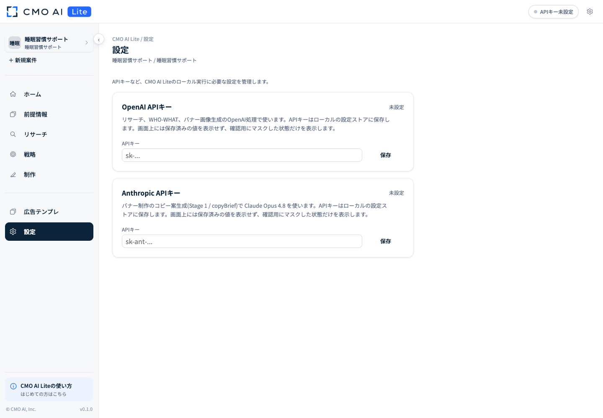

# セットアップマニュアル

[READMEへ戻る](../README.md) · [利用マニュアルへ](user-manual.md)

CMO AI Liteを初めて使う方向けのセットアップ手順です。セットアップは初回のみ必要です。

## Codex / Claude Codeにセットアップを任せる場合はこちら

すでにCodexまたはClaude Codeを利用できる方は、CMO AI Liteのダウンロード、セットアップ、起動をエージェントへ依頼できます。

CodexまたはClaude Codeへ、以下の文章をそのまま送ってください。

```txt
以下のCMO AI Liteを、Gitを使わずに最新版のZIPからダウンロード・解凍してください。

私自身にはターミナル操作を求めず、必要なセットアップと起動作業を実行して、ブラウザで使える状態まで進めてください。

https://github.com/k4415/CMO-AI-Lite

条件：
・Git、git clone、git pullは使わない
・既存ファイルを削除・上書きする場合は事前に確認する
・Node.js 20以上が入っているか確認する
・必要な依存関係をインストールする
・CMO AI Liteを起動する
・http://localhost:5173 が開けるところまで確認する
・APIキーを会話上へ表示しない
・管理者権限や本人の操作が必要な時だけ案内する
```

途中で処理の許可を求められた場合は、内容を確認して許可してください。

Node.jsのインストール、管理者権限、APIキーの入力など、本人による操作が必要な箇所ではエージェントから案内されます。

セットアップが完了してCMO AI Liteの画面が開いたら、下記の[「6. APIキーを設定する」](#api-keys)へ進んでください。

## 1. 事前に用意するもの

- Node.js 20以上
- OpenAI APIキー：事実リサーチ、WHO-WHAT、バナーのStage 2、gpt-image-2画像生成に使用
  - [OpenAI Platform](https://platform.openai.com/)
- Anthropic APIキー：バナーのStage 1（copyplan / copyBrief）とデザイン散文の作成に使用
  - [Claude Console](https://platform.claude.com/)

UIからAIを実行すると、OpenAI APIとAnthropic APIはそれぞれの利用内容に応じて従量課金されます。料金や利用条件は各提供元で確認してください。

## 2. Node.jsをインストールする

### Windowsの場合

PowerShellで次のコマンドを実行します。

```txt
winget install -e --id OpenJS.NodeJS.LTS
```

インストール後、PowerShellをいったん閉じて開き直してください。

### macOSの場合

ターミナルで次のコマンドを実行します。

```txt
brew install node
```

Homebrewが未インストールの場合は、[Homebrew公式サイト](https://brew.sh/)の案内を確認し、次のコマンドでHomebrewをインストールしてください。

```txt
/bin/bash -c "$(curl -fsSL https://raw.githubusercontent.com/Homebrew/install/HEAD/install.sh)"
```

### バージョンを確認する

PowerShellまたはターミナルで次のコマンドを実行します。

```txt
node -v
npm -v
```

Node.jsのバージョンがv20以上なら準備完了です。コマンドでのインストールがうまくいかない場合は、[Node.js公式サイト](https://nodejs.org/)からLTS版をインストールしてください。

## 3. CMO AI Liteを配置する

[最新版のZIPをダウンロード](https://github.com/k4415/CMO-AI-Lite/releases/latest/download/CMO-AI-Lite.zip)して展開するか、Gitで取得します。

```txt
git clone https://github.com/k4415/CMO-AI-Lite.git
```

ZIPを展開すると `CMO-AI-Lite` フォルダになります。任意の場所へ配置してください。

## 4. 必要ファイルをインストールする

`CMO-AI-Lite` フォルダで次のコマンドを実行します。

```txt
npm install
```

LPのスクリーンショット分析に使うChromeも自動で準備されます。通常はChromeを別途設定する必要はありません。

## 5. アプリを起動する

`CMO-AI-Lite` フォルダで次のコマンドを実行します。

```txt
npm run dev
```

ブラウザで [http://localhost:5173](http://localhost:5173/) を開きます。PowerShellまたはターミナルを閉じるとアプリも停止します。終了するときは、起動した画面で `Ctrl+C` を押してください。

<a id="api-keys"></a>

## 6. APIキーを設定する

1. CMO AI Liteを開く
2. 画面右上の歯車、またはサイドバーの「設定」を開く
3. OpenAI APIキーを入力して保存する
4. Anthropic APIキーを入力して保存する
5. 画面右上が「OpenAI / Anthropic 設定済み」になったことを確認する

APIキーはPC内の `local-secrets/openai.json` と `local-secrets/anthropic.json` に保存され、Git管理の対象外です。APIキーをチャット、案件名、商品情報へ貼り付けないでください。



### OpenAI・Anthropic APIの利用枠を有効にする

ChatGPTの有料プランとOpenAI API、Claudeの有料プランとAnthropic APIは、それぞれ別に請求・管理されます。
APIキーを作成・保存しただけでは、CMO AI LiteのAI機能を実行できない場合があります。

#### OpenAI API

OpenAI PlatformのBillingで、利用可能なクレジットまたは請求設定を確認してください。

[https://platform.openai.com/settings/organization/billing](https://platform.openai.com/settings/organization/billing)

#### Anthropic API

Claude Consoleの「Settings → Billing」で、支払い方法を登録し、API用のUsage Creditsを購入してください。

[https://platform.claude.com/](https://platform.claude.com/)

クレジット残高がなくなると、バナーStage 1のコピー設計を実行できません。
必要に応じて自動チャージを設定できますが、想定外の課金を防ぐため上限も確認してください。

CMO AI Liteの「設定済み」表示は、APIキーがPCに保存されていることを示すだけです。
APIキーの有効性、クレジット残高、利用上限は確認していません。

## 7. 初回動作を確認する

1. 「新規案件」を押す
2. 商品名を入力する（商品名がそのまま案件名になります）
3. LP / 記事LPのURLを入力する
4. 必要に応じて簡易説明を入力する
5. 「商品を登録して作成」を押す
6. 案件が作成され、ホーム画面が表示されることを確認する
7. 不要なテスト案件は案件メニューからアーカイブする

ここまで確認できればセットアップ完了です。

## 8. バックアップする

次のフォルダとファイルを定期的にコピーしてください。

- `projects`：案件情報、リサーチ、戦略、バナー案、生成画像
- `data/ad-templates.json`：全案件共通の広告テンプレDB
- `data/ad-template-uploads`：追加した広告テンプレ画像

APIキーをバックアップする場合は `local-secrets` を安全な場所で管理してください。第三者へ渡す配布物には含めないでください。

## 9. よくあるトラブル

### localhost:5173が開かない

PowerShellまたはターミナルで `npm run dev` が実行中か確認してください。

### ポートが使用中と表示される

Windows PowerShellでは次を実行します。

```txt
$env:PORT=5174
npm run dev
```

macOSでは次を実行します。

```txt
PORT=5174 npm run dev
```

その後、[http://localhost:5174](http://localhost:5174/) を開きます。

### APIキーが未設定と表示される

「設定」を開き、OpenAI APIキーとAnthropic APIキーをそれぞれ保存し直してください。

### npm installでChromeの準備に失敗する

インターネット接続を確認して、次を実行します。

```txt
npm run setup-browser
```

### LP解析で本文や画像を取得できない

ログイン必須ページや取得制限のあるページでは、URLだけで解析できない場合があります。「前提情報」の商品説明や、資料本文の取り込みで必要な情報を補ってください。

### 「You exceeded your current quota, please check your plan and billing details」と表示される

OpenAI APIのクレジットが不足しているか、月間利用上限・組織またはプロジェクトの支出上限に達しています。
APIキーを保存し直すだけでは解消しません。

- Billingで残高と支払い方法を確認する
- 必要に応じてクレジットを追加する
- Limitsで利用上限を確認する
- 複数のOrganization / Projectがある場合は、課金設定を行ったProjectのAPIキーを使用しているか確認する
- 設定変更後、数分待ってから再実行する

このエラーは「Rate limit reached（短時間にリクエストしすぎた）」とは異なります。
待って再実行するだけでは解消しない場合があります。

### Anthropic APIでバナー生成が止まる

バナーStage 1のコピー設計で課金・クレジットに関するエラーが表示された場合は、Claude Consoleの「Settings → Billing」を確認してください。

- Usage Creditsの残高を確認する
- 必要に応じてクレジットを購入する
- APIキーが、クレジットを購入したOrganizationのものか確認する
- 自動チャージの上限に達していないか確認する
- 確認後、バナー生成を再実行する

## 10. データ・費用・利用条件

- 案件データと画像はローカルPCへ保存されます
- 実案件データとAPIキーはGit管理の対象外です
- UI実行では、リサーチ・WHO-WHAT・Stage 2・画像生成にOpenAI API、Stage 1のコピー設計とデザイン散文の作成にAnthropic APIを使用します
- Claude Code / Codexのサブスク実行モードではテキスト生成をエージェント側で行い、画像生成だけは常にOpenAI APIを使用します
- 画像生成はgpt-image-2、品質の既定値はmediumです
- CMO AI Liteは厳密なOSSではなく、株式会社Icraが権利を持つソース公開版です。利用前に[LICENSE](https://github.com/k4415/CMO-AI-Lite/blob/main/LICENSE)を確認してください

---

[動画マニュアルを見る](https://youtu.be/OXbziptw5dk)
