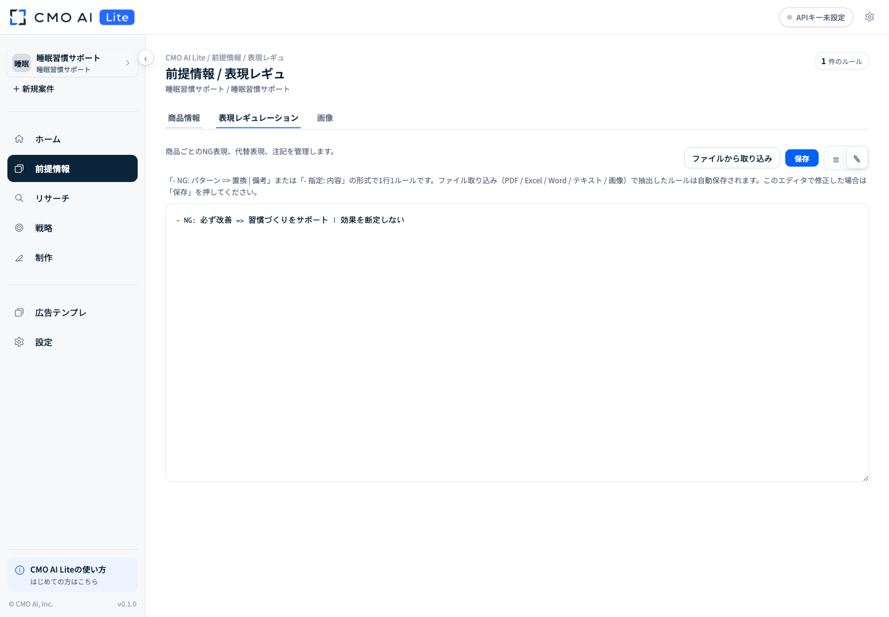
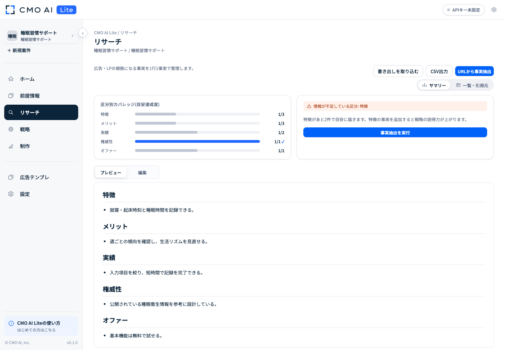
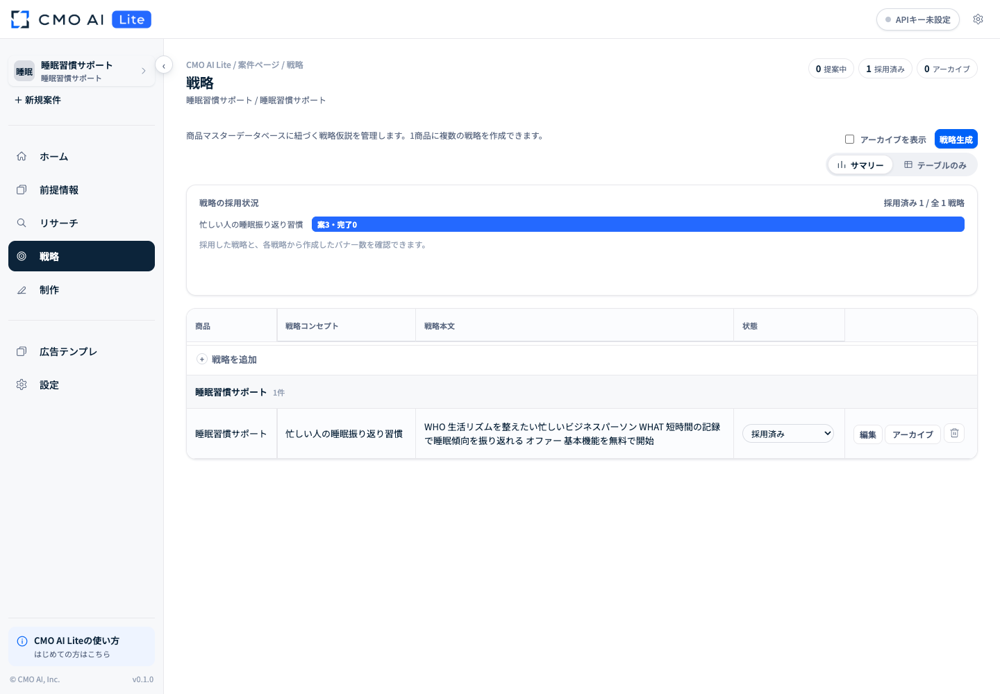
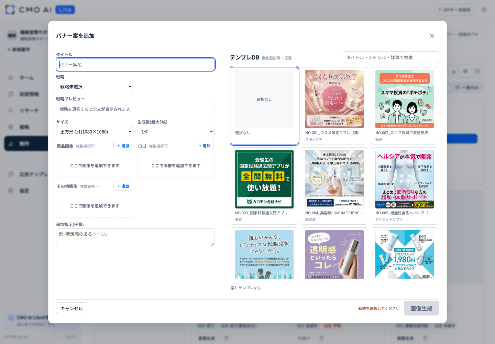

# 利用マニュアル

[READMEへ戻る](../README.md) · [セットアップマニュアルへ](setup-manual.md)

CMO AI Liteは、1案件=1商品で「前提情報 → 事実リサーチ → WHO-WHAT戦略 → バナー画像テンプレ → バナー制作」を進めるローカルアプリです。

## 最初に確認すること

- アプリが起動している
- 画面右上が「OpenAI / Anthropic 設定済み」になっている
- 1つの案件には1つの商品だけを登録する
- UI実行では、リサーチ・WHO-WHAT・Stage 2・画像生成にOpenAI API、Stage 1のコピー設計とデザイン散文の作成にAnthropic APIを使用する
- Claude Code / Codexのサブスク実行モードではテキスト生成をエージェント側で行い、画像生成だけは常にOpenAI APIを使用する

## 全体の流れ

1. 新規案件を作成する
2. 商品情報、画像、ロゴ、表現レギュレーションを登録する
3. LP解析と8方向の網羅リサーチを実行する
4. 5区分の事実と参照元を確認する
5. WHO-WHAT戦略を生成・編集する
6. 広告テンプレを選んでバナーを生成する
7. 完成画像を確認・修正・ダウンロードする
8. 良い構成を広告テンプレDBへ蓄積する

## 1. 案件を作成する

1. サイドバーの「新規案件」を押す
2. 商品名を入力する（商品名がそのまま案件名になります）
3. LP / 記事LPのURLを入力する
4. 必要に応じて簡易説明を入力する
5. 「商品を登録して作成」を押す

案件作成と同時に商品情報が登録されます。別の商品を扱う場合は、新しい案件を作成してください。

### 案件を切り替える

サイドバー上部の案件名を押し、一覧から対象案件を選びます。

### 案件をアーカイブする

案件一覧のメニューから「アーカイブ」を選びます。データは削除されません。「アーカイブ済み一覧」から復元できます。

## 2. 前提情報を登録する

「前提情報」には、商品情報、表現レギュレーション、画像があります。

### 商品情報

商品名、LP / 記事LP、商品説明、ブランドトーンなどを確認・編集します。生成結果の前提になるため、事実と異なる内容は入力しないでください。

### 商品画像とロゴ

「画像」タブ、または制作画面から追加できます。

- 商品画像：商品の形状やパッケージが分かる画像
- ロゴ：背景が単純で、文字が読みやすい公式データ
- その他：人物、利用シーン、参考素材など

生成時に選択した画像は後から合成するのではなく、gpt-image-2へ参照画像として直接渡します。商品画像、ロゴ、その他画像はそれぞれ複数選択できます。

### 表現レギュレーション

NG表現、推奨表現、理由、備考を登録します。「ファイルから取り込み」ではPDF / Excel / Word / テキスト / 画像を読み込めます。抽出したルールは自動保存され、エディタで修正した場合は「保存」を押して反映します。



## 3. LP解析と事実リサーチを実行する

1. 「前提情報 > 商品情報」を開く
2. LP / 記事LPのURLを確認する
3. 「LP解析 + 網羅リサーチ」を押す
4. リサーチ画面に表示される処理状況を確認する

次の処理が実行されます。

- LP / 記事LPの本文取得
- スクリーンショット取得と画像内文字の分析
- 登録済みURLの文字起こし
- 公式、口コミ、比較、メディア、専門家、運営会社、市場・競合、リスクの8方向Web検索
- 特徴、メリット、実績、権威性、オファーの5区分への整理

解析済みURLはキャッシュされ、同じ内容の再取得を抑えます。



## 4. 事実と参照元を確認する

リサーチ画面では、5区分の充足状況、事実本文、参照元URLを確認できます。

- 「サマリー」：5区分の事実をまとめて確認
- 「一覧・引用元」：1行1事実と参照元URLを確認・編集
- 「編集」：5区分の事実本文を直接修正
- 「保存」：編集内容を案件DBへ反映

Web由来の事実は参照元URLと組み合わせて保存されます。生成前に、価格、実績、期間、No.1表現など重要な数値の根拠を確認してください。

## 5. 戦略を生成・編集する

1. 「戦略」を開く
2. 「戦略生成」を押す
3. 提案されたWHO-WHAT案を確認する
4. 使う案を「採用済み」にする

戦略は商品情報、事実、表現レギュレーションをもとに複数提案されます。

- 「サマリー」：採用状況を確認
- 「テーブルのみ」：戦略本文を一覧で確認・編集
- 「編集」：戦略本文と状態を直接修正
- 「アーカイブ」：不要な案を一覧から外す

バナー生成では保存済みの戦略本文を使用します。編集したら必ず保存してください。



## 6. バナー案を追加して生成する

1. 「制作」を開く
2. 「バナー案を追加」を押す
3. タイトルと使用する戦略を指定する
4. サイズと生成数を選ぶ（最大5枚）
5. 必要に応じて広告テンプレを複数選ぶ
6. 商品画像、ロゴ、その他画像を選ぶ
7. 必要に応じて追加指示を入力する
8. 「画像生成」を押す

複数テンプレを選んだ場合は、選択順に各案へ割り当てられ、不足分は先頭から再利用されます。複数案では1回のcopyplanで基準案とバリエーション案のコピーを設計し、その後に各案のpromptJsonと画像を処理します。

画像生成は標準で最大10件を同時実行し、11件目以降は待機列から順番に開始します。



## 7. 生成状況を確認する

制作画面では、主に次の状態を確認できます。

- 未着手
- コピー・プロンプト作成中
- 画像生成可能
- 画像生成待ち
- 生成中
- 修正中
- 完了
- 完了（警告あり）
- 再生成が必要
- 確認が必要
- 失敗
- 中断・再開可能

待機中の案は空いた枠から自動で開始します。「中断・再開可能」と表示された案は「生成を再開」を押してください。警告や失敗がある場合は、詳細に表示される理由を確認してください。

## 8. 完成画像を確認・修正する

バナーを選択して詳細画面を開きます。

- 生成画像を拡大して確認
- 使用した広告テンプレ画像を確認
- 戦略、コピー、参照素材、生成状態を確認
- 画像をダウンロード
- 再生成
- 範囲指定修正：画像上で最大5か所の矩形範囲を選び、範囲ごとの修正指示を入力
- 全体修正：画像全体に対する修正指示を入力

画像内のロゴ、価格、実績、注釈、CTAは公開前に目視確認してください。ロゴ確認やファクトチェックで警告が出た場合は、そのまま入稿しないでください。

## 9. 広告テンプレDBを使う

広告テンプレDBは全案件共通です。テーブル表示とギャラリー表示を切り替えられます。

### 既存テンプレを使う

バナー案追加画面でテンプレ画像と内容を確認し、生成に使うものを選択します。テンプレは任意で、選択しなくても生成できます。

### 新しいテンプレを登録する

1. 「広告テンプレ」を開く
2. 「バナーをテンプレ化」を押す
3. 必要に応じてテンプレ名を入力する
4. 参考バナー画像を選択する
5. 「テンプレ化」を押す
6. AI解析の完了後、構造、テンプレ字コンテ、成功要因、変数定義を確認する
7. 必要に応じて編集する

商品名やコピーだけを保存するのではなく、構図、情報階層、視線誘導、成功要因を再利用できる形で保存します。


## 10. Codex / Claude Codeから操作する

`CMO-AI-Lite` フォルダをCodexまたはClaude Codeで開くと、ターミナルから案件DBを操作できます。

指示例：

```txt
この案件のLPを解析して事実リサーチを進めてください。
この戦略とテンプレを使ってバナーを5案作成してください。
未生成のバナーを確認して画像生成を再開してください。
```

エージェントは[AGENTS.md](https://github.com/k4415/CMO-AI-Lite/blob/main/AGENTS.md)、[docs/agent-operations.md](https://github.com/k4415/CMO-AI-Lite/blob/main/docs/agent-operations.md)、[config/prompts](https://github.com/k4415/CMO-AI-Lite/tree/main/config/prompts)を読み、既存のAPIと保存形式を使います。

利用者スキルは次の4件です。

- `cmoai-research`：商品登録、内部LP解析、事実抽出
- `cmoai-who-what`：WHO-WHAT戦略提案
- `cmoai-banner`：バナー案、copyBrief、promptJson、画像生成
- `cmoai-template`：バナー画像テンプレ化

サブスク実行モードではテキスト生成をCodex / Claude Code側で行います。画像生成は常に `POST /api/banners/generate-image` からgpt-image-2を実行するため、OpenAI APIの従量課金が発生します。

## 11. データをバックアップする

案件データは `projects` 配下に保存されます。案件を別PCへ移す場合は、アプリを停止してから案件フォルダ全体をコピーしてください。

全案件共通の広告テンプレも移す場合は、次もコピーします。

- `data/ad-templates.json`
- `data/ad-template-uploads`

APIキーも移す場合は `local-secrets` を安全に取り扱い、第三者へ渡す配布物には含めないでください。

## 12. 利用条件

CMO AI Liteは厳密なOSSではなく、株式会社Icraが権利を持つソース公開版です。自社・クライアント業務での利用範囲や、販売・再配布・SaaS化などの禁止事項は[LICENSE](https://github.com/k4415/CMO-AI-Lite/blob/main/LICENSE)を確認してください。

---

[動画マニュアルを見る](https://youtu.be/OXbziptw5dk)
